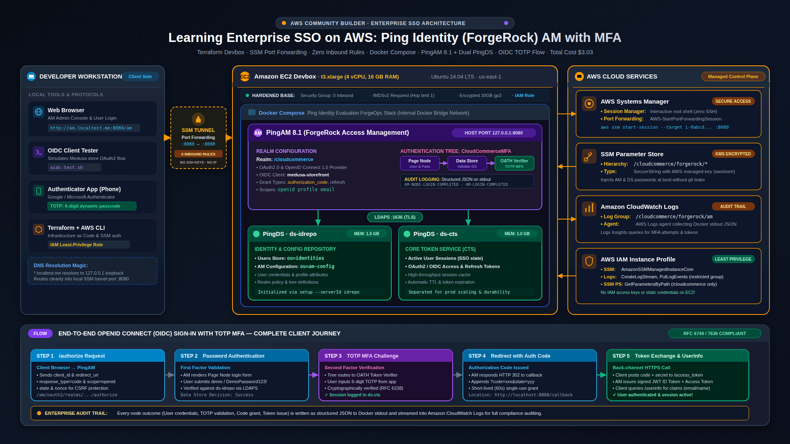

# Learning Enterprise SSO on AWS: Ping Identity (ForgeRock) AM with MFA

A hands-on learning project: PingAM and PingDS (ForgeRock) on an SSM-only EC2 instance, configured as an OpenID Connect provider with TOTP multi-factor authentication. Secrets live in SSM Parameter Store and every login is audited in CloudWatch Logs.

**📖 Read the full write-up:** [docs/article.md](docs/article.md) · [AWS Builder Center article](#) <!-- TODO: paste the Builder Center link after publishing -->



## What's in here

```
terraform/devbox/          EC2 dev box: SSM only, no inbound ports, IMDSv2, encrypted gp3
  main.tf                  instance, IAM role (AmazonSSMManagedInstanceCore), security group
  aws_integrations.tf      CloudWatch log group + least-privilege role policy (logs, SSM params)
forgerock/
  docker-compose.yml       PingDS (ds-idrepo, ds-cts) + PingAM from the public ForgeOps images
  docker-compose.aws.yml   overlay: ship AM logs to CloudWatch (awslogs driver)
  scripts/bootstrap.sh     dev CA, DS certificates, AM keystore (8 aliases), .env
  scripts/oidc-test.sh     end-to-end OIDC auth-code test: state, nonce, tokens, UserInfo
  scripts/secrets-to-ssm.sh / secrets-from-ssm.sh   .env <-> SSM Parameter Store (SecureString)
docs/
  article.md               the article, step by step, with 13 real problems and fixes
project-screenshots/       screenshots used in the article (sensitive ones blurred)
```

## Quick start

Prerequisites: AWS account, Terraform ≥ 1.6, AWS CLI v2, Session Manager plugin, an authenticator app.

```bash
# 1. Dev box
cd terraform/devbox && terraform init && terraform apply
$(terraform output -raw connect)                 # shell via SSM, no SSH

# 2. On the dev box (as ubuntu)
git clone <this repo> && cd cloudcommerce-sso/forgerock
./scripts/bootstrap.sh && docker compose up -d

# 3. On your laptop: port-forward AM through SSM
aws ssm start-session --target <instance-id> --document-name AWS-StartPortForwardingSession \
  --parameters '{"portNumber":["8080"],"localPortNumber":["8080"]}'
# open http://am.localtest.me:8080/am  (user: amadmin, password in forgerock/.env)
```

Realm, identity store, OAuth2 provider, OIDC client and the MFA tree are configured in the AM console. The article lists every setting.

## Cost and cleanup

The whole project cost **$3.03** (t3.xlarge, stopped whenever not in use). When finished:

```bash
cd terraform/devbox && terraform destroy
aws ssm delete-parameters --names $(aws ssm get-parameters-by-path \
  --path /cloudcommerce/forgerock --query 'Parameters[].Name' --output text)
```

## Notes

- **Learning setup, not production.** AM runs over plain HTTP with Secure cookies turned off, DS bind accounts use the ForgeOps default password, and there is a single instance. See the "Limitations" section of the article.
- The container images are Ping Identity's public ForgeOps **evaluation** images. Production use requires a license from Ping Identity.
- Nothing secret is committed: `.env`, generated certificates/keystores, DS data and Terraform state are gitignored.

## Series

1. **Ping Identity (ForgeRock) AM with MFA on AWS** ← this repo
2. SSO for an open-source e-commerce store (MedusaJS) with ForgeRock AM
3. ForgeRock Identity Gateway
4. ForgeRock IDM for provisioning
5. ForgeOps on Amazon EKS
