# Learning Enterprise SSO on AWS: Ping Identity (ForgeRock) AM with MFA on EC2, SSM, Parameter Store and CloudWatch

*A hands-on learning project with my AWS Community Builder credits: an SSM-only EC2 instance built with Terraform, PingAM and PingDS in Docker Compose, OpenID Connect single sign-on with TOTP multi-factor authentication, secrets in SSM Parameter Store, every login audited in CloudWatch Logs, and everything that broke along the way.*

**Code:** https://github.com/asifMuzammil/cloudcommerce-sso

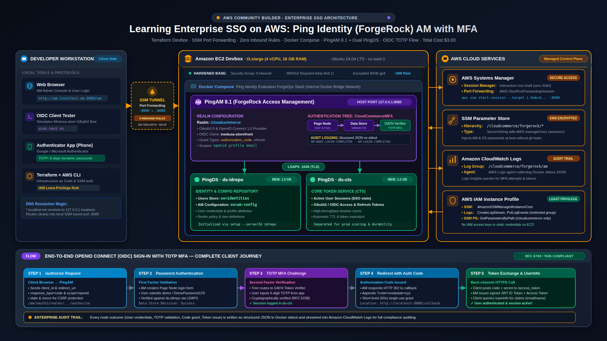

## Introduction

As an AWS Community Builder I received AWS credits, and I wanted to spend them on something I did not understand yet: enterprise identity. Not a managed login service this time, but Ping Identity's ForgeRock Access Management, the kind of identity provider large companies run themselves.

So I started a small learning project. I created an EC2 instance with Terraform, reached it only through AWS Systems Manager (no SSH key, no open ports), and learned SSM port forwarding so I could open the AM console from my laptop. Later I added SSM Parameter Store for secrets and CloudWatch Logs for the audit trail. On top of that I configured AM as an OpenID Connect provider with TOTP multi-factor authentication.

Honestly, this project was hard for me. I started with zero Ping Identity background. AM came up fine the first time. Then I restarted it, and it showed me its first-time setup wizard, as if it had never been installed at all. That was one of thirteen problems I hit, and I'll go through every one of them here.

By the end you will have:

- An SSM-only EC2 "dev box" built with Terraform: no SSH key, no inbound ports, an IAM instance role instead of access keys
- PingDS (users and AM configuration, plus a separate token store) and PingAM running from Ping's public ForgeOps images
- A realm with an OIDC client, a TOTP MFA login tree, and a script that tests the whole authorization code flow
- Secrets in SSM Parameter Store (SecureString) and AM's audit events in CloudWatch Logs
- A table of every error I hit, why it happened and how I fixed it

> The ForgeOps images are Ping Identity's public **evaluation** images. They are fine for learning. Production use needs a license.

## Why a single EC2 instance?

Ping's official deployment kit (ForgeOps) targets Kubernetes, and that is the right choice for production. For learning, a cluster adds ingress, cert-manager, StatefulSets and secret generators before you see a single AM screen, and an EKS cluster big enough for AM and DS costs money every hour.

I wanted the smallest setup that still uses the real images. The price: everything Kubernetes normally does for these images (TLS certificates, secrets, init containers) I had to do by hand. That's where I ended up learning the most.

| Decision | Choice | Why |
|---|---|---|
| Compute | 1 × EC2 `t3.xlarge` (16 GB) | AM + 2 × DS need about 6 GB; my laptop has 7 GB in total |
| Access | SSM Session Manager + port forwarding | No SSH keys, no open ports |
| Orchestration | Docker Compose | Closest to ForgeOps without a cluster |
| Directory | Two DS containers | Same split as production: users/config vs. session tokens |
| Protocol | OIDC authorization code flow | What modern apps speak; my next project is an e-commerce store |

## Prerequisites

- An AWS account and an IAM user for Terraform. I used `PowerUserAccess` plus a small inline policy that only allows IAM roles named `cloudcommerce-*` (in the repo)
- Terraform 1.6+, AWS CLI v2 and the Session Manager plugin
- A phone with an authenticator app (Google Authenticator, ForgeRock Authenticator, and so on)

## Step 1: An SSM-only dev box with Terraform

The security group has **no inbound rules at all**. The SSM agent connects out to AWS, so shell access and port forwarding still work.

```hcl
resource "aws_security_group" "devbox" {
  name        = "cloudcommerce-devbox-sg"
  description = "Dev box: no inbound, all outbound (SSM, docker pulls)"
  vpc_id      = data.aws_vpc.default.id
  egress {
    from_port   = 0
    to_port     = 0
    protocol    = "-1"
    cidr_blocks = ["0.0.0.0/0"]
  }
}

resource "aws_instance" "devbox" {
  ami                    = data.aws_ssm_parameter.ubuntu_2404.value  # latest Ubuntu, no hard-coded AMI
  instance_type          = "t3.xlarge"
  iam_instance_profile   = aws_iam_instance_profile.devbox.name   # AmazonSSMManagedInstanceCore
  vpc_security_group_ids = [aws_security_group.devbox.id]
  user_data              = file("${path.module}/user_data.sh")     # Docker, AWS CLI, 4 GB swap

  metadata_options {
    http_tokens = "required"                                       # IMDSv2 only
  }
  root_block_device {
    volume_size = 40
    volume_type = "gp3"
    encrypted   = true
  }
}
```

```bash
cd terraform/devbox && terraform init && terraform apply
$(terraform output -raw connect)      # runs: aws ssm start-session --target i-...
```

Proof that nothing is open:

```bash
aws ec2 describe-security-groups --filters Name=group-name,Values=cloudcommerce-devbox-sg \
  --query 'SecurityGroups[0].IpPermissions'
# []
```

Every resource gets a `Project=cloudcommerce-sso` tag through `default_tags`, so the project's cost shows up on its own in Cost Explorer. When I paused, I stopped the instance instead of destroying it. That keeps the disk and the AM configuration and only costs storage.

## Step 2: Find out what the images expect

Before writing a compose file I read the images' startup scripts:

```bash
docker run --rm --entrypoint sh us-docker.pkg.dev/forgeops-public/images/ds:8.1.2-latest \
  -c 'cat docker-entrypoint.sh env.sh'
```

Each Kubernetes feature they rely on needed a Docker replacement:

| Kubernetes provides | The image expects | My replacement |
|---|---|---|
| cert-manager | `tls.crt/tls.key/ca.crt` under `/var/run/secrets/...` | A small dev CA made with `openssl` |
| Init container | `docker-entrypoint.sh init`, then `start-ds` | `sh -c "./docker-entrypoint.sh init && exec ./docker-entrypoint.sh start-ds"` |
| emptyDir | Writable `/var/run/secrets/keys` | `tmpfs` mount |
| Pod name | `POD_NAME=ds-idrepo-0` picks the right setup script | `environment: POD_NAME` |
| Secret generator | AM `keystore.jceks` with fixed key names (aliases) | `keytool`, borrowed from the AM image |

The key names came from AM's own configuration inside the image:

| Alias | Type | Used for |
|---|---|---|
| `rsajwtsigningkey` | RSA 2048 | Signing OIDC ID tokens (RS256) |
| `es256test`, `es384test`, `es512test` | EC P-256/384/521 | ES* token signing |
| `test`, `selfserviceenctest` | RSA 2048 | Encryption |
| `hmacsigningtest` | HMAC-SHA256 | HS256 signing |
| `directenctest` | AES-256 | Direct JWE encryption |

`forgerock/scripts/bootstrap.sh` creates all of it: the CA, DS certificates, DS admin passwords, the AM keystore, an Amster key pair and a `.env` file. It also fixes file ownership, because the containers run as uid `11111` and group `0`. I don't commit anything secret: `.gitignore` covers `secrets/`, `data/` and `.env`.

## Step 3: Docker Compose for DS and AM

The full file is in the repo. These are the parts that matter:

```yaml
x-ds: &ds
  image: us-docker.pkg.dev/forgeops-public/images/ds:8.1.2-latest
  entrypoint: ["sh", "-c", "./docker-entrypoint.sh init && exec ./docker-entrypoint.sh start-ds"]
  tmpfs: ["/var/run/secrets/keys:mode=1777"]

services:
  ds-idrepo: { <<: *ds, hostname: ds-idrepo, environment: { POD_NAME: ds-idrepo-0 }, mem_limit: 1536m }
  ds-cts:    { <<: *ds, hostname: ds-cts,    environment: { POD_NAME: ds-cts-0 },    mem_limit: 1g }
  am:
    image: us-docker.pkg.dev/forgeops-public/images/am:8.1.1-latest
    environment:
      FQDN: am.localtest.me                    # resolves to 127.0.0.1
      AM_SERVER_PROTOCOL: http
      AM_SERVER_PORT: "8080"
      AM_STORES_USER_SERVERS: ds-idrepo:1636   # LDAPS
      AM_STORES_CTS_SERVERS: ds-cts:1636
      AM_ENCRYPTION_KEY: ${AM_ENCRYPTION_KEY}  # fixed, not random on each restart
    ports: ["127.0.0.1:8080:8080"]             # only AM, only on localhost
    mem_limit: 3g
```

- `mem_limit` is required. DS sets its heap to 65 % of the container's memory, and without a limit it sizes itself from the whole 16 GB host.
- Only AM is published, and only on `127.0.0.1`. DS stays inside the compose network and talks LDAPS.
- `am.localtest.me` always resolves to `127.0.0.1`. That's exactly where the SSM tunnel ends on my laptop, so no `/etc/hosts` editing.

```bash
./scripts/bootstrap.sh && docker compose up -d
# on the laptop:
aws ssm start-session --target <instance-id> --document-name AWS-StartPortForwardingSession \
  --parameters '{"portNumber":["8080"],"localPortNumber":["8080"]}'
# browser: http://am.localtest.me:8080/am  (user amadmin)
```

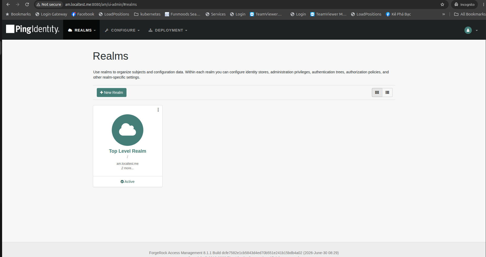

## Step 4: Realm, identity store and a test user

I kept the Top Level Realm for administrators and created a realm called **`cloudcommerce`** for application users. I left the DNS alias empty: `am.localtest.me` already belongs to the root realm, so the new realm is selected with `?realm=/cloudcommerce` in the URL.

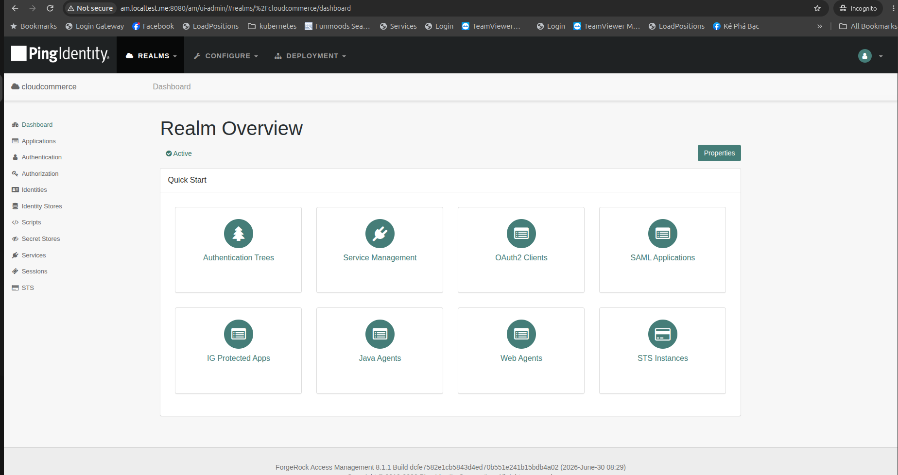

AM created a default identity store that points to `ds-idrepo:1636` and `ou=identities`. My first attempt to create a user failed: first a "Not Found" message, then an LDAP error.

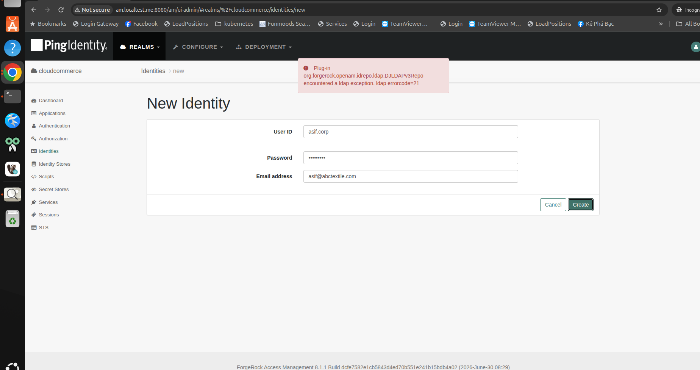

The AM log said the entry `fr-idm-uuid=asif.corp,ou=people,ou=identities` had an invalid value for `fr-idm-uuid`. I checked the DS schema: that attribute only accepts UUIDs. The ForgeOps configuration expects users to be created by ForgeRock IDM, which gives every user a UUID. I was running AM alone, so AM used the username in that place, and DS rejected it. This was the moment I understood that AM and IDM have different jobs. One setting fixed it:

| Identity store → User Configuration | ForgeOps default | Standalone AM |
|---|---|---|
| LDAP Users Search Attribute | `fr-idm-uuid` | **`uid`** |

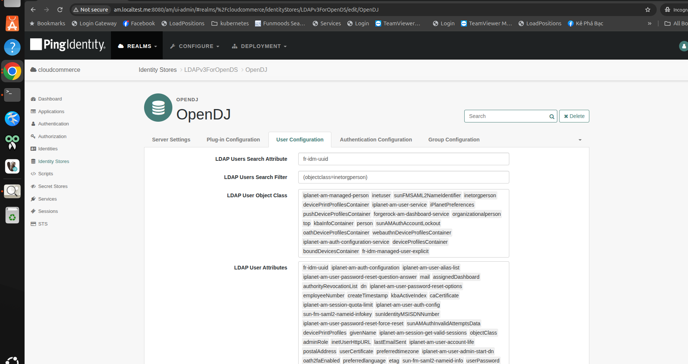

After that the user `asif.corp` was created. Because an admin set the password, AM asked the user to change it at the first login, which is normal enterprise behavior.

## Step 5: Turn AM into an OIDC provider

1. **Services → Add a Service → OAuth2 Provider**, with the defaults.

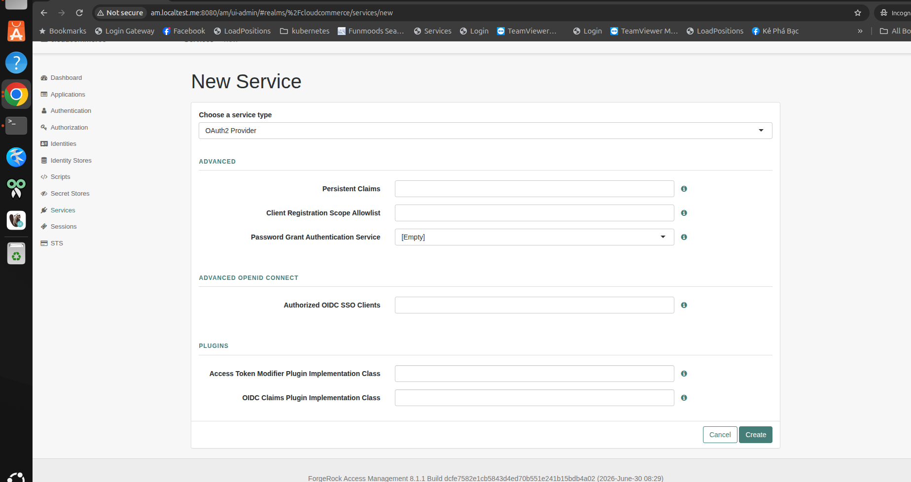

2. Check the discovery document. The issuer must exactly match what clients see:

```bash
curl -s -H "Host: am.localtest.me:8080" \
  http://localhost:8080/am/oauth2/realms/root/realms/cloudcommerce/.well-known/openid-configuration \
  | jq '{issuer, authorization_endpoint, token_endpoint, userinfo_endpoint, jwks_uri}'
```

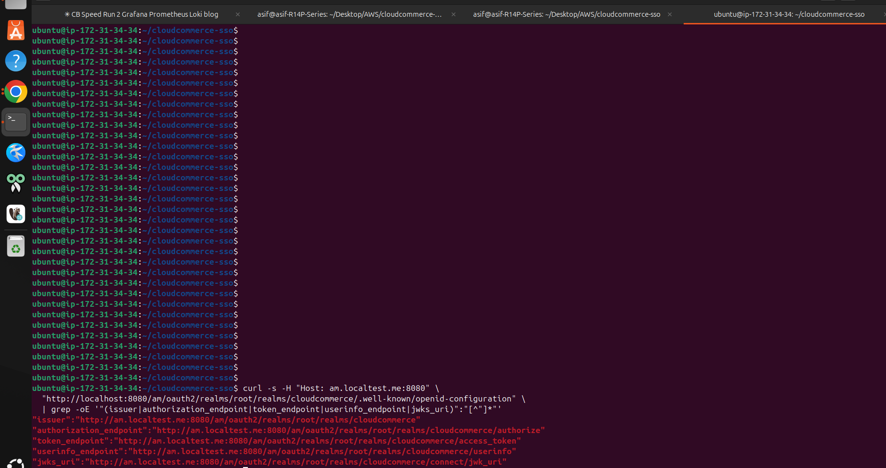

3. **Applications → OAuth 2.0 → Clients → Add Client:**

| Setting | Value | Why |
|---|---|---|
| Client ID | `medusa-storefront` | My next project connects an e-commerce store to this client |
| Client secret | `openssl rand -hex 24`, kept in a gitignored `.env` | Never in shell history or git |
| Redirection URI | `http://localhost:8000/auth/forgerock/callback` | Where the app receives the code |
| Scopes | `openid`, `profile`, `email`, one entry each | See troubleshooting #7 |
| Implied consent | On for the client **and** "Allow Clients to Skip Consent" on the provider | First-party app; both switches are needed |

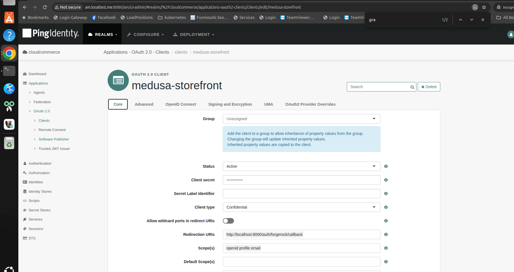

## Step 6: A TOTP MFA login tree

In AM, an authentication tree decides how a user logs in. Mine is called `CloudCommerceMFA`:

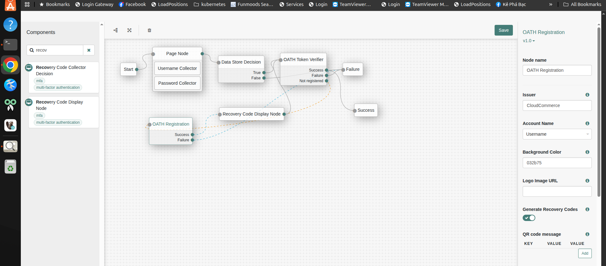

| Node | Outcome → next node |
|---|---|
| Start | → Page Node (Username Collector + Password Collector on one screen) |
| Page Node | → Data Store Decision |
| Data Store Decision | true → OATH Token Verifier · false → Failure |
| OATH Token Verifier (TOTP) | success → Success · failure → Failure · not registered → OATH Registration |
| OATH Registration (TOTP, issuer `CloudCommerce`, recovery codes on) | success → Recovery Code Display · failure → Failure |
| Recovery Code Display | → OATH Token Verifier (the user confirms the first code) |

The canvas got messy, so instead of trusting the picture I checked the wiring through AM's REST API (full command in the repo):

```bash
curl -s -H "iPlanetDirectoryPro: $TOKEN" -H "Accept-API-Version: resource=1.0" \
  ".../json/realms/root/realms/cloudcommerce/realm-config/authentication/authenticationtrees/trees/CloudCommerceMFA" \
  | jq -r '...'
# Start -> Page Node
# Data Store Decision: true -> OATH Token Verifier
# OATH Token Verifier: notRegisteredOutcome -> OATH Registration
# Recovery Code Display Node: outcome -> OATH Token Verifier
# ...
```

Then I made this tree the realm's default login, so every login in the realm, OIDC logins included, needs MFA. I didn't set it per user. One forgotten user setting and you have an MFA bypass. The console change also didn't stick the first time, so I checked it, and set it, through REST:

```bash
curl ... realm-config/authentication | jq '.core.orgConfig = "CloudCommerceMFA" | del(._id,._rev,._type)' \
  | curl -X PUT ... --data @- realm-config/authentication
# { "orgConfig": "CloudCommerceMFA", "adminAuthModule": "ldapService" }
```

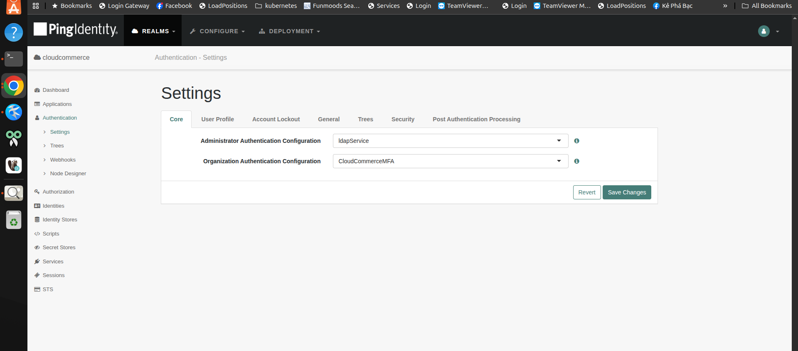

For the screenshots I created a throwaway `demo.user` and deleted it afterwards. First login: username and password, then a QR code to scan, then recovery codes, then the first 6-digit code.

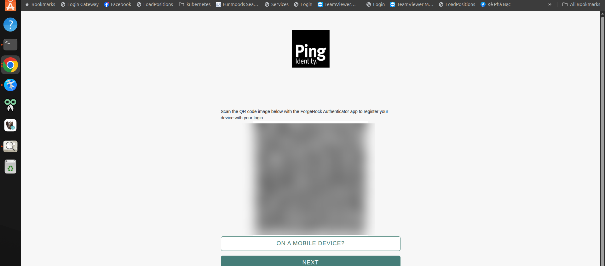

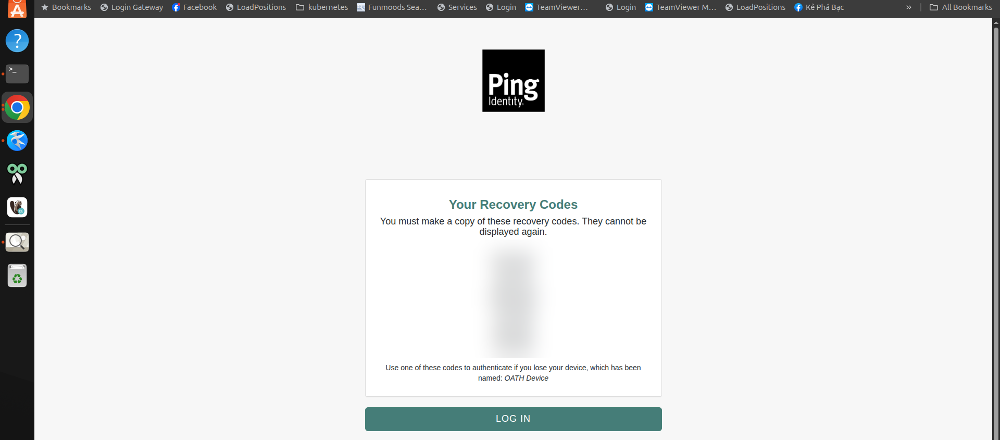

On the next login only the code is needed:

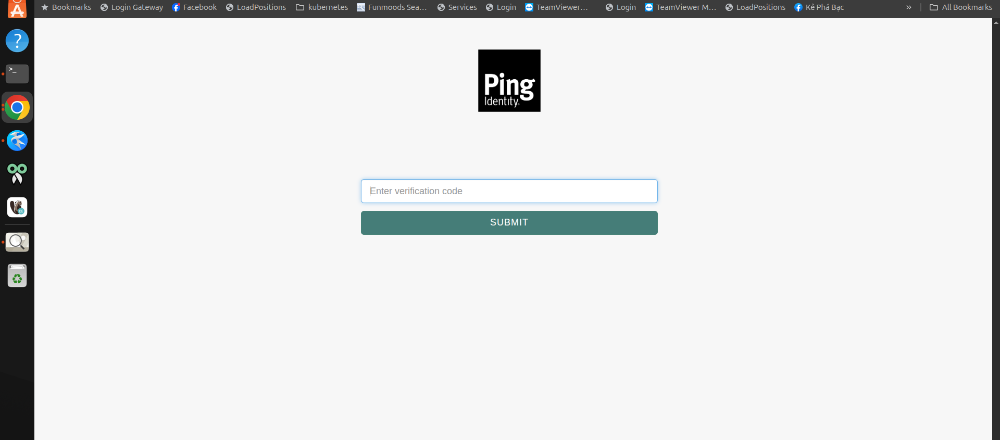

## Step 7: Test the whole flow without an app

`forgerock/scripts/oidc-test.sh` acts as the application. It builds an authorize URL with a random `state` and `nonce`, takes the returned code, exchanges it for tokens with the client secret, decodes the ID token and calls UserInfo. On my laptop, `python3 -m http.server 8000` stands in for the app's callback page, so the code shows up in the terminal.

Logging in through this flow, AM asked for the password and then the TOTP code:

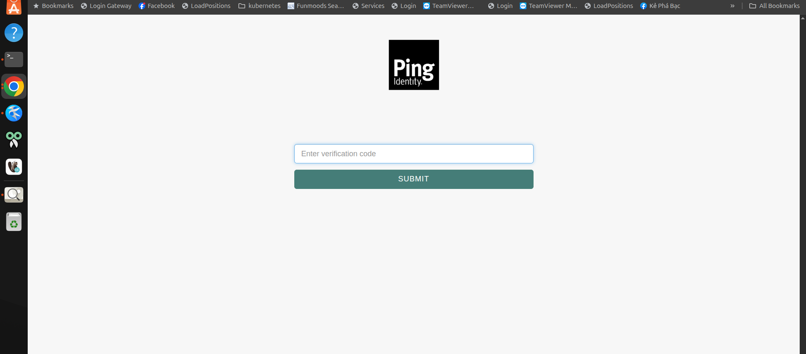

And the client received its tokens:

```
OK: tokens received (scope: openid profile email)
ID token claims:
{ "iss": "http://am.localtest.me:8080/am/oauth2/realms/root/realms/cloudcommerce",
  "aud": "medusa-storefront", "sub": "asif.corp", "nonce": "5dd92731eacf1f60", ... }
(expected nonce: 5dd92731eacf1f60)
UserInfo: { "sub": "asif.corp", "email": "asif@abctextile.com", "given_name": "Asif", ... }
```

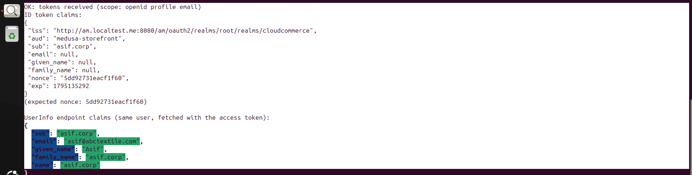

The application never saw a password or a TOTP code. It only got a signed token after AM checked both factors. One detail that surprised me: AM put the profile claims (email, name) in UserInfo, not in the ID token. So the app should read `sub` from the ID token and profile data from UserInfo.

## Step 8: Secrets in Parameter Store, audit logs in CloudWatch

Up to here the secrets sat in a file on the instance, and the logs only existed inside Docker. Two small Terraform additions (`terraform/devbox/aws_integrations.tf`) fixed that:

```hcl
resource "aws_cloudwatch_log_group" "am" {
  name              = "/cloudcommerce/forgerock/am"
  retention_in_days = 7
}

resource "aws_iam_role_policy" "devbox_runtime" {
  role = aws_iam_role.devbox.id
  policy = jsonencode({ Version = "2012-10-17", Statement = [
    { Effect = "Allow", Action = ["logs:CreateLogStream", "logs:PutLogEvents", "logs:DescribeLogStreams"],
      Resource = [aws_cloudwatch_log_group.am.arn, "${aws_cloudwatch_log_group.am.arn}:log-stream:*"] },
    { Effect = "Allow", Action = ["ssm:GetParameter", "ssm:GetParametersByPath", "ssm:PutParameter"],
      Resource = "arn:aws:ssm:us-east-1:<account>:parameter/cloudcommerce/forgerock/*" },
  ]})
}
```

`terraform plan` showed `2 to add, 0 to change, 0 to destroy`, so the running instance and its AM configuration were not touched.

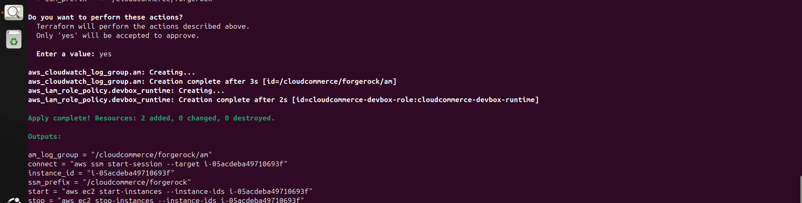

**Secrets.** The instance uses its IAM role. There are no access keys on it:

```bash
aws sts get-caller-identity --query Arn --output text
# arn:aws:sts::<account>:assumed-role/cloudcommerce-devbox-role/i-...
./forgerock/scripts/secrets-to-ssm.sh     # .env values -> SecureString (values never printed)
./forgerock/scripts/secrets-from-ssm.sh   # SecureString -> .env (mode 600) on a new box
```

The amadmin password, AM's encryption key, the shared secret, the subject-hash salt and the OIDC client secret now live under `/cloudcommerce/forgerock/*`, encrypted with the AWS-managed `aws/ssm` KMS key, outside git and independent of the instance.

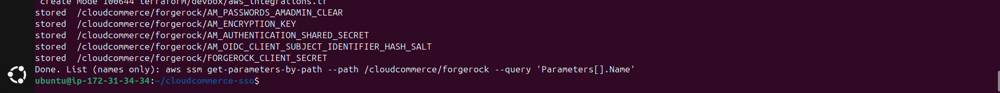

**Audit logs.** A compose overlay switches only the AM container to Docker's `awslogs` driver. Docker uses the instance role here too:

```yaml
# forgerock/docker-compose.aws.yml
services:
  am:
    logging:
      driver: awslogs
      options:
        awslogs-region: us-east-1
        awslogs-group: /cloudcommerce/forgerock/am
        awslogs-stream: am
        mode: non-blocking
```

AM writes its audit events as JSON, so CloudWatch Logs Insights can query them directly. This query lists each step of a login through the MFA tree:

```
fields @timestamp, eventName, principal.0 as user,
       entries.0.info.displayName as node, entries.0.info.nodeOutcome as outcome, result
| filter realm = "/cloudcommerce" and eventName like /LOGIN-COMPLETED/
| sort @timestamp asc
```

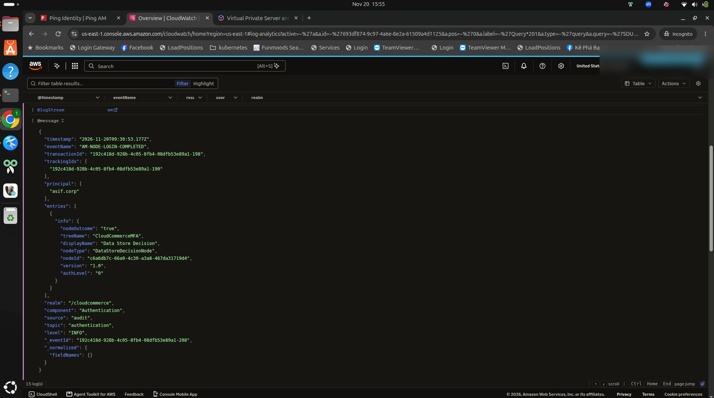

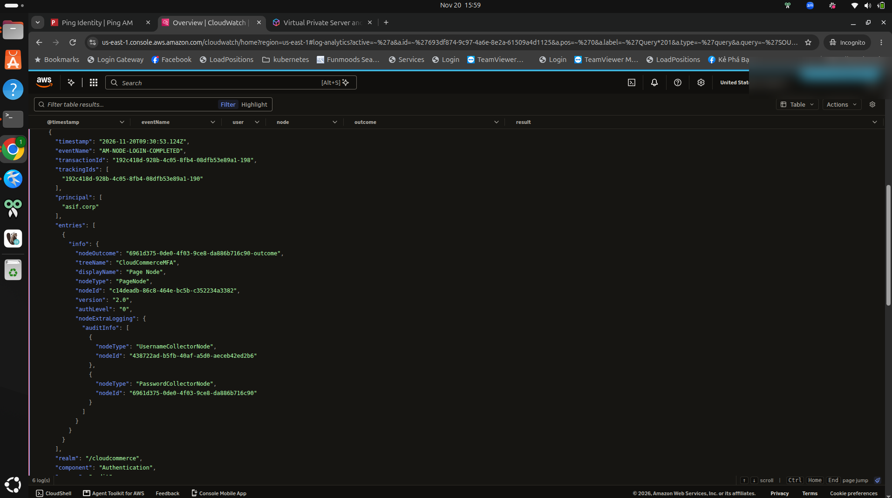

Every event carries the user (`asif.corp`), the realm, the tree (`CloudCommerceMFA`) and the node that ran: the Page Node that collected the username and password, `Data Store Decision → true`, then the OATH Token Verifier. That's an audit trail of both factors, and I didn't have to log in to the instance once to read it.

Small embarrassing moment: at first I couldn't find the log group in the console at all. Wrong region. The log group was in `us-east-1`, my console wasn't.

## Troubleshooting: everything that broke

| # | Symptom | Cause | Fix |
|---|---|---|---|
| 1 | AM console says **"Unauthorized access"** with the right password | The ForgeOps config hard-codes `com.iplanet.am.cookie.secure=true`; over `http://` the browser drops the session cookie | Dev only: set it to `false` in the compose command. Production: HTTPS (ALB + ACM) and keep `true` |
| 2 | After a restart every request goes **302 → `/am/config/options.htm`**, and the log says **"Can't open boot keystore"** | On first boot AM rewrites `boot.json` to read its config-store password from the main keystore, and writes that entry into `keystore.jceks`. On every start the entrypoint copies the original keystore back | Save a pristine `boot.json` on first start and restore it before each start. ForgeOps never hits this because its AM pods are thrown away on restart |
| 3 | Login **401** right after regenerating `.env` | Docker Compose gives **shell variables priority over `.env`**; I had exported the old values earlier with `set -a; . ./.env` | `unset` them; load `.env` only inside a `( subshell )` |
| 4 | DS sizes itself from the whole host | Heap = 65 % of container memory | `mem_limit` on each DS container |
| 5 | Creating a user: **"Not Found"**, then **LDAP error 21** | The identity store uses `fr-idm-uuid` (UUID syntax) because ForgeOps expects IDM to create users | Users Search Attribute → `uid` |
| 6 | A realm user's login ends on **"Forbidden"** | The default success URL is `/am/console`, which is for admins | Harmless; apps receive the user through the OIDC redirect |
| 7 | `?error=invalid_scope` | I typed the scopes as one string; AM's field needs Enter after each scope | Re-enter `openid`, `profile`, `email` separately |
| 8 | Consent page despite "Implied consent" | The provider-level "Allow Clients to Skip Consent" was off | Turn on both |
| 9 | `access_denied: Resource Owner Session not valid` | The browser still had a session for a user I had just deleted | Clear cookies or use a new private window |
| 10 | Realm default tree "saved", but no MFA prompt | The console change did not persist | Check with GET, set with PUT |
| 11 | The SSM tunnel stops working | Session Manager idle timeout (about 20 minutes) | Start the port-forwarding session again |
| 12 | AWS CLI: `Provided region_name '<!DOCTYPE html…'` | No region in the profile, so the CLI asked `169.254.169.254`, and my home router answered with an HTML page | Set the region; `AWS_EC2_METADATA_DISABLED=true` on the laptop |
| 13 | CloudWatch log group "missing" | The console was in another region | Switch the console to `us-east-1` |

Problem 2 cost me the most time. My first guess was the port. Wrong. Then I suspected the Docker volume, and a quick test seemed to clear it, but the volume really was involved: the error only showed up on the second start. I reproduced it on my laptop and used `find -newer` to list which files AM changes during its first boot. That pointed straight at `boot.json`. The lesson I took from this project: read the error code and the logs, and prove the cause before changing anything.

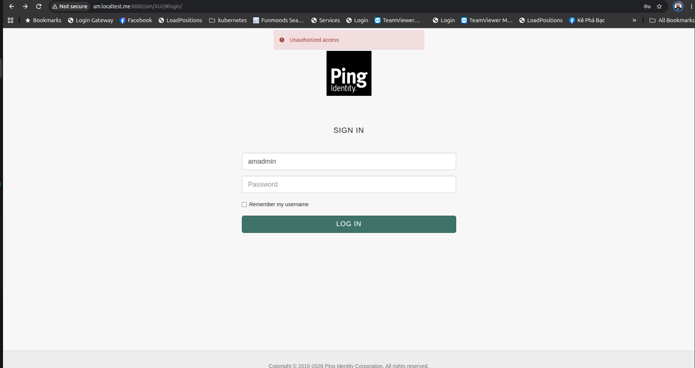

## Limitations: what I would change for production

This is a learning setup, and it shows. Before production I'd change:

- HTTPS everywhere: AM behind an ALB with an ACM certificate, Secure cookies back on, and the proxy forwarding `Host` and `X-Forwarded-Proto`.
- The certificates and AM keystore. Runtime secrets are already in Parameter Store, but these are still files on the instance. They belong in Secrets Manager, with rotation.
- Directory bind passwords. The ForgeOps DS setup scripts create AM's bind accounts with the password `password`. Yes, really.
- One subtree per realm. The new realm's store shares `ou=identities` with the root realm.
- `sub` is the username today. An immutable ID (or pairwise subjects) is better.
- I configured AM by clicking in the console. Next time I'd export the config into git.
- One instance, no replication. For production, ForgeOps on EKS is the way.

## Cost and cleanup

| Item | Price (us-east-1) |
|---|---|
| EC2 `t3.xlarge` | about $0.17 per hour, only while running |
| 40 GB gp3 | about $3.20 per month while it exists |
| CloudWatch Logs, Parameter Store (standard) | a few cents at this volume |

My total for the whole project, from Cost Explorer: **$3.03**. Almost all of it was EC2 compute and the instance's EBS disk, plus a few cents for its public IPv4 address. Stopping the instance whenever I paused is what kept it this low. My Community Builder credits covered all of it.

When you are done:

```bash
cd terraform/devbox && terraform destroy        # instance, role, security group, log group
aws ssm delete-parameters --names $(aws ssm get-parameters-by-path \
  --path /cloudcommerce/forgerock --query 'Parameters[].Name' --output text)
```

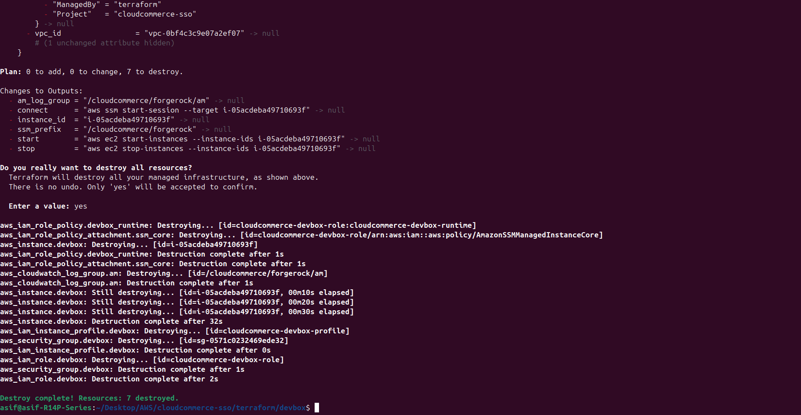

The Parameter Store secrets survive `terraform destroy` on purpose (Terraform does not own them), so delete them yourself. Also delete the access key of the IAM user you used for Terraform.

## What I learned, and what's next

Before this project I had no Ping Identity background. Now I know what a realm is, how AM uses DS, how a login tree decides each step, and what an application actually receives through OIDC. I like exploring tools I haven't used before, and that's why I picked Ping Identity for this one. It was my first Ping project, so I've only scratched the surface; next I want to go much deeper into how AM, DS and IDM work together. My biggest lesson wasn't really about ForgeRock, though. Kubernetes does a lot of things quietly (certificates, secrets, init containers), and I only saw them because I had to do each one by hand.

This is part 1 of a series:

1. **Ping Identity (ForgeRock) AM with MFA on AWS** (this post)
2. Single sign-on for an open-source e-commerce store (MedusaJS) with ForgeRock AM
3. ForgeRock Identity Gateway in front of an application
4. ForgeRock IDM for user provisioning
5. The full ForgeOps stack on Amazon EKS

If you've run ForgeRock AM outside Kubernetes and found a cleaner fix for the `boot.json` restart problem, please tell me in the comments. I'd really like to know.

---
*Tags: #security-identity #amazon-ec2 #aws-systems-manager #amazon-cloudwatch #terraform*
